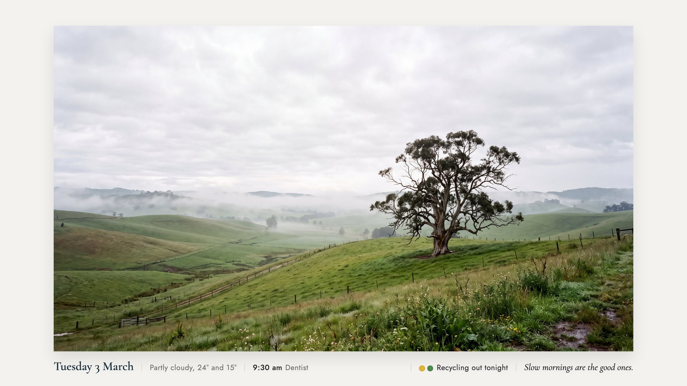
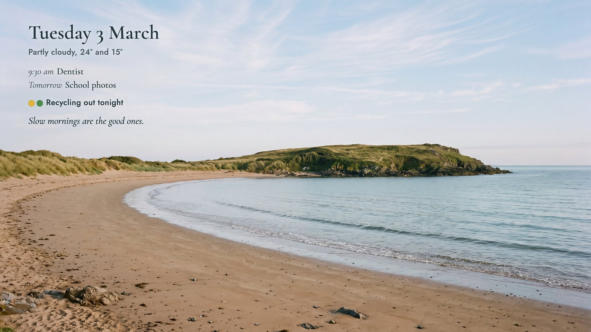
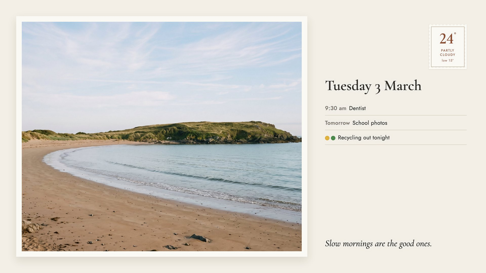

# Smart Frame TV

A fresh picture on your Samsung The Frame every morning: one of your own photos, with the day, the
weather, what is on today and tomorrow, and any reminders, set like a label in a gallery. It stays
real Art Mode, so the motion sensor, the brightness sensor and the low power all keep working, and
pressing power still takes you straight to TV.

| Gallery | Sky |
|---|---|
|  |  |
| **Minimal** | **Postcard** |
|  |  |

*Sample pictures, made with `smartframe preview --sample` and the three sample photos in
`samples/photos`. The details on them are made up.*

What it does, in one breath: a small Python tool on a computer at home (a Mac, a Linux box or a
Raspberry Pi) makes the picture at 3840x2160, sends it to the Frame over your Wi-Fi, shows it, and
deletes yesterday's. It never touches the photos you put on the TV yourself.

**Contents:** [Will it work on my TV?](#will-it-work-on-my-tv) ·
[How it works](#how-it-works) · [What you need](#what-you-need) ·
[TV settings](#tv-settings-to-check) · [Setup, step by step](#setup-step-by-step) ·
[Your photos](#choosing-your-photos) · [Styles](#styles) · [What it can show](#what-it-can-show) ·
[Calendar links](#getting-a-calendar-link) · [Schedule](#schedule) ·
[Old pictures](#keeping-or-deleting-old-pictures) · [Troubleshooting](#troubleshooting) ·
[Undo](#undo) · [Privacy](#privacy-and-safety) · [Set up with an AI agent](#set-it-up-with-an-ai-agent)

## Will it work on my TV?

| TV | Works? |
|---|---|
| **Samsung The Frame, 2021 to 2024** | **Yes.** Tested on a 2021 Frame (Art Mode API 2.03). 2022 to 2024 use the same connection and are reported working by others. |
| Samsung The Frame 2025, Frame Pro | Probably, not yet confirmed. Run `smartframe check` first. |
| Samsung The Frame 2020 and older | Possibly. The 2020 models use the same art connection; untested here. |
| LG Gallery / Gallery+, TCL NXTFRAME and T-Exhibition, Google TV and Chromecast, Apple TV | Not supported. These can only show a photo album from Google Photos or iCloud, not a picture sent from your own computer. A photo album route may come later. |
| Hisense CanvasTV, Fire TV Omni, Sony, Philips, Meural | Not supported. No way found to send a picture to them from a computer at home. |

Details and sources: [docs/COMPATIBILITY.md](docs/COMPATIBILITY.md).

## How it works

```
   your photos folder        weather (Open-Meteo)      your calendar link (optional)
          |                          |                          |
          +--------------------------+--------------------------+
                                     |
                 an always-on computer at home, on the same Wi-Fi
                 (Mac, Linux, Raspberry Pi), every 5 minutes asks:
                 "is it time, and is the TV answering?"
                                     |
           1. picks today's photo and crops it to 16:9
           2. lays out the words in your style (headless Chrome)
           3. saves a 3840x2160 JPEG
                                     |
                         home Wi-Fi, port 8002 (Art Mode)
                                     |
                         Samsung The Frame, Art Mode
           4. uploads it to My Photos     5. shows it
           6. deletes the older pictures this tool made, and only those
```

Art Mode can only show still pictures, so the picture is made fresh and sent, rather than being a
live web page. That is also why it has no clock on it: it would be wrong a minute later.

## What you need

- **Samsung The Frame**, connected to your home Wi-Fi.
- **A computer that stays on**, on the same Wi-Fi as the TV. It does the work, so it must be awake
  at the time you choose. A Mac mini, an old laptop that stays plugged in with sleep switched off,
  a Linux box or a **Raspberry Pi** (3B+, 4 or 5) all work. A laptop that sleeps or leaves the house
  does not count, because the TV cannot make its own picture.
  - Mac: System Settings, Energy (or Battery, Options), switch on **Prevent automatic sleeping
    when the display is off**.
  - Raspberry Pi: Raspberry Pi OS (Bookworm or newer) with the desktop or Lite.
- **Python 3.10 or newer.** Check with `python3 --version`.
- **Google Chrome or Chromium.** It lays out the words (see [Why Chrome](#why-chrome)).
  Mac: install Chrome as usual. Raspberry Pi and Debian or Ubuntu: `sudo apt install chromium`
  (on older systems `chromium-browser`).
- **Your own photos**, landscape ones look best.
- Internet for the weather and your calendar only.

## TV settings to check

Menu names move a little between years. These are the 2021 to 2024 names; on each Frame you get
there from the remote with **Settings** (or Home, then Settings).

**Needed**

1. **Same Wi-Fi as the computer.** Settings, General, Network, Network Status. Write down the TV's
   **IP address** here; you will need it. Not a guest network, and the router must not keep
   devices apart ("client isolation" or "AP isolation" off).
2. **Allow this computer when asked.** The first time the tool connects, the TV shows a prompt
   asking to allow a device called "SmartFrame". Choose **Allow**. Where to change it later:
   Settings, General, External Device Manager, **Device Connection Manager**. "Access
   Notification" should be **First Time Only** (if it is Off, some TVs refuse new devices without
   asking). The **Device List** there shows SmartFrame and lets you remove it.
3. **Power goes to Art Mode.** On the Frame, a short press of the power button switches between TV
   and Art Mode. A long press turns the TV fully off. Fully off, the TV drops off the Wi-Fi and
   gets no picture until it is back on (the tool waits and tries again by itself).

**Recommended**

4. **Motion sensor, so the screen goes dark when nobody is in the room.** In Art Mode settings
   (from Art Mode, press down on the remote or open Settings, General, Art Mode settings):
   **Sleep After** (or Motion Detection) set to 15 or 30 minutes, and **Motion Detection
   Sensitivity** to medium. The screen comes back when someone walks in.
5. **Brightness sensor, so the picture matches the room's light.** In the same Art Mode settings:
   **Brightness Sensor** (or Auto Brightness) on. On 2022 and newer models, **Night Mode** turns
   the screen off in a dark room.
6. **Auto Power Off off.** Settings, General, **Eco Solution**, Auto Power Off: Off. Otherwise the
   TV can switch itself fully off after a few hours without a button press.
7. **Power On with Mobile and IP Remote on**, if your TV has them: Settings, General, Network,
   **Expert Settings**. They keep the TV's network side awake in standby, which makes it more
   likely to answer the computer. (Waking a fully off Frame over the network did not work on the
   2021 model we tested, so the tool never relies on it.)
8. **A fixed address for the TV.** In your router's app, give the TV a "DHCP reservation" so its
   IP address never changes. Without it, things still work until the router hands out a new
   address; then put the new one in `config.json`.

**Not needed:** Developer Mode, a Samsung account, SmartThings, or anything installed on the TV.

## Setup, step by step

The commands below are typed in Terminal (Mac) or a terminal on Linux, in the `smart-frame-tv`
folder. Each step tells you what you should see.

**1. Get the code.** Download it from GitHub (Code, Download ZIP, then unzip) or:

```sh
git clone https://github.com/Seagey/smart-frame-tv.git
cd smart-frame-tv
```

**2. Install it** into its own private Python folder (nothing outside this folder changes):

```sh
python3 -m venv .venv
.venv/bin/pip install -r requirements.txt
.venv/bin/pip install -e .
```

Check: `.venv/bin/smartframe --version` prints `smartframe 0.1.0`.

**3. Find the TV.** Switch the Frame on (TV or Art Mode), then:

```sh
.venv/bin/smartframe find
```

It lists Samsung TVs on your Wi-Fi with their addresses, marking the Frame. Nothing found? Try
`find --scan`, or read the address off the TV (TV settings, step 1). On a Mac, if it asks to
"find devices on your local network", choose Allow.

**4. Write your settings.**

```sh
cp config.example.json config.json
```

Open `config.json` in any text editor and change at least:
- `frame.ip`: the TV's address from step 3.
- `timezone`: yours, for example `Australia/Melbourne`, `Europe/London`, `America/New_York`.
- `place.name`: your suburb or city, for the weather (never a street address).
- `photos.folder`: where your photos are (a `photos` folder inside this one is the default).

Everything else can stay as it is for now. Every setting is explained in
[docs/CONFIG.md](docs/CONFIG.md).

**5. Add photos.** Make the folder and copy a few landscape photos in:

```sh
mkdir photos
```

**6. Pair with the TV.** Stand where you can see the TV and run:

```sh
.venv/bin/smartframe pair
```

The TV shows a prompt asking to allow "SmartFrame". Choose **Allow** with the remote within about
30 seconds. You should see `Paired`. (Some Frames, the 2021 ones among them, connect without
asking; then it says `This TV did not need a token`. Both are fine.)

**7. Check it** (read only, changes nothing on the TV):

```sh
.venv/bin/smartframe check
```

You should see `Art Mode: supported`, the API version, and what is showing.

**8. Look at a picture before it goes on the TV:**

```sh
.venv/bin/smartframe preview --all
```

It saves one picture per style in the `data` folder (`data/preview-gallery.png` and so on). Open
them, pick a style and put it in `config.json` (`"style": "sky"` for example). Run preview again
after any change until you like it.

**9. Send the first one:**

```sh
.venv/bin/smartframe run
```

The TV switches to the new picture in a few seconds. You should see `showing MY_F...`. If the TV
is in TV mode, it shows next time you press power for Art Mode.

**10. Turn on the daily schedule:**

```sh
scripts/schedule.sh install
```

That is it. From tomorrow, a new picture arrives at the time you chose. `scripts/schedule.sh
status` says whether it is on and shows the last lines of the log.

## Choosing your photos

Put photos in the folder named in `photos.folder` (`.jpg`, `.jpeg`, `.png`, `.webp`, and iPhone
`.heic` when `pillow-heif` installed). Add or remove photos any time; the next picture uses
whatever is there.

**How it picks** (`photos.pick`):

| Setting | What happens |
|---|---|
| `"day"` (default) | A new photo every day, working through the folder in name order. Same photo all day. |
| `"rotate"` | The next photo every time a picture is made. Good with `every_hours`. |
| `"random"` | Any photo, never the same twice in a row. |
| `"fixed"` | Always the one named in `photos.file`, for example `"file": "favourite.jpg"`. |

**Photos for a date:** start a file name with the month and day, like `12-25 tree.jpg` or
`06-14 birthday.jpg`. That photo shows on that day every year and is skipped on all other days.

**Cropping:** photos are cropped to the TV's 16:9 shape from the middle. If the important part is
near an edge, set `photos.focus` to `"top"`, `"bottom"`, `"left"` or `"right"`. Portrait photos
lose a lot in the crop, so landscape ones look best. Photos smaller than 4K are enlarged; 1920
pixels wide or more looks good on the TV.

To try one photo: `.venv/bin/smartframe preview --photo path/to/photo.jpg`.

## Styles

Set `"style"` in `config.json`. The pictures at the top show each one.

| Style | Look | Where the words go (`"position"`) |
|---|---|---|
| `gallery` | The photo in a warm white mat with a soft shadow; a museum-style label underneath. | Always under the photo. `...-left` starts the label at the left; `...-right` sets it to the right. |
| `sky` | The photo full screen; the day in large type with the details beneath, set in the sky. | Any corner: `top-left`, `top-right`, `bottom-left`, `bottom-right`. |
| `minimal` | The photo full screen; small, spaced type in one corner. | Any corner. |
| `postcard` | The photo with a white border on a paper background; a written side with a stamp showing the temperature. | `...-left` puts the written side on the left; `...-right` on the right. |

On `sky` and `minimal` the writing turns dark on a light sky and light on a dark one by itself
(`"ink": "auto"`). Force it with `"ink": "dark"` or `"ink": "light"`. The gallery mat colour can
be changed with `"mat"`, for example `"mat": "#ece8e1"`.

## What it can show

Each item is a block in the `"blocks"` list. Their order in the list is their order on the
picture. Turn one off with `"on": false`, or take it out.

| Block | What it shows | Its settings |
|---|---|---|
| `date` | "Tuesday 3 March" | `date_order`: `"day-month"` or `"month-day"` ("Tuesday, March 3") |
| `weather` | "Partly cloudy, 24° and 15°" (today's high and low) | `place.name` (suburb or city, plus `place.country` like `"AU"` if the name is common) or `place.latitude` and `place.longitude`; `weather.units` `"celsius"` or `"fahrenheit"`; `weather.show_place` adds the place name; `weather.rain_chance` adds "40% chance of rain" when it is 20% or more |
| `calendar` | "9:30 am Dentist", "Tomorrow School photos" | `calendar.ics_urls` (one or more links), `days` (1 = today only, 2 = today and tomorrow), `max` (how many), `hide` (words that hide an event), `empty_text` (shown when there is nothing; `""` for nothing at all); `clock` `"12h"` or `"24h"` |
| `reminders` | "Bins out tonight", with coloured dots if you like | a list in `"reminders"`: `text`, `days` (`["mon"]`, `["tue", "fri"]`), optional `every_weeks` and `start` for every second week, optional `dots` colours |
| `quote` | A line of your own, in italics | `quote.text` for one line, or `quote.lines` for a different line each day |

**Reminders, two examples.** Every Monday:

```json
{"text": "Bins out tonight", "days": ["mon"]}
```

Every second Thursday, starting on a Thursday you name, with two coloured dots:

```json
{"text": "Recycling out tonight", "days": ["thu"], "every_weeks": 2, "start": "2026-01-08", "dots": ["#e2b33c", "#4a8a4a"]}
```

Reminders show only on their day. Times of day are not needed: the picture is made in the morning.

**How much fits:** the gallery label is one line, so with weather, three events and a reminder it
gets full; events that do not fit are left off the end. Fewer events (`"max": 2`) keeps it calm.

## Getting a calendar link

The tool reads any calendar that has an "iCal" or ".ics" link. Paste it into
`calendar.ics_urls`. Several links can go in the list. Treat these links like a key: anyone with
one can read that calendar, and `config.json` is never shared by git.

- **Google Calendar:** on a computer, open Google Calendar, Settings (the gear), then on the left
  your calendar under "Settings for my calendars", then **Integrate calendar**, and copy **Secret
  address in iCal format**.
- **iCloud (iPhone):** Calendar app, Calendars, the (i) next to the calendar, switch on **Public
  Calendar**, then **Share Link** and copy it. It may start with something other than `https`; paste it as it is, the tool handles that. (This
  makes the calendar readable by anyone with the link.)
- **Outlook.com and Microsoft 365:** Outlook on the web, Settings, Calendar, **Shared calendars**,
  "Publish a calendar", choose the calendar and "Can view all details", Publish, then copy the
  **ICS** link.

Changes in your calendar show up in the next picture. The calendar is read at most every 10
minutes.

## Schedule

```json
"schedule": {"start_hour": 5, "every_hours": 0}
```

- `start_hour`: the earliest hour of the day it makes a picture (0 to 23, your time zone).
- `every_hours`: `0` is one picture a day. `3` makes a new one every 3 hours from `start_hour`
  (handy with `"pick": "rotate"` for a changing gallery).

`scripts/schedule.sh install` sets up a background job that runs `smartframe run --when-due` every
5 minutes. That does nothing until it is time, and nothing while the TV is off, so a TV that is
first switched on at noon still gets the day's picture. The job: launchd on a Mac
(`~/Library/LaunchAgents`), a systemd user timer on Linux, or cron if there is no systemd.
`scripts/schedule.sh remove` turns it off.

On a Raspberry Pi or other Linux box, so the timer also runs when nobody is logged in:
`sudo loginctl enable-linger $USER`.

If you would rather write your own cron line:

```
*/5 * * * * cd /path/to/smart-frame-tv && .venv/bin/smartframe run --when-due >> data/smartframe.log 2>&1
```

### Windows

Not tested. The tool is plain Python and should run, with Chrome or Edge for the layout. Use Task
Scheduler: a task that runs every 5 minutes with the program
`C:\path\to\smart-frame-tv\.venv\Scripts\smartframe.exe` and the arguments
`--config C:\path\to\smart-frame-tv\config.json run --when-due`. The computer must not sleep.

## Keeping or deleting old pictures

```json
"keep_previous": 0
```

`0` (default) keeps only today's picture on the TV: after showing the new one, the older ones this
tool made are deleted. `3` keeps the three before it as well, so you can flick back to them in Art
Mode.

**Your own photos are never touched.** The tool keeps a list of every picture it uploaded in
`data/state.json` and deletes only those. It also checks that the TV still describes each one the
way it was sent: after a factory reset the TV starts numbering again, and a number on the list
could now belong to one of your photos, so that one is left alone.

## Troubleshooting

| What you see | What to do |
|---|---|
| `The Frame at ... is not answering` | The TV is fully off, asleep in a way that drops the Wi-Fi, or on another network. Press power once (Art Mode) and run again. The schedule waits for the TV by itself. Check the address (TV settings, step 1). |
| `The Frame did not accept this computer` | The TV forgot the pairing (a factory reset, a long time unplugged, or the device was removed in Device Connection Manager). Run `smartframe pair` and choose Allow. |
| No Allow prompt appears when pairing | Settings, General, External Device Manager, Device Connection Manager: Access Notification to First Time Only, and check SmartFrame is not on the Device List as Deny. Then pair again. |
| `the Frame did not get ready for the picture` or `never listed it` | The TV was busy (starting up, switching mode). Wait a minute and run again. It never sends a second copy: it checks My Photos first. |
| The picture changed on the TV but it shows TV, not art | Normal: the new picture is selected for Art Mode. Press power once. |
| Works when you run it, not from the schedule (Mac) | macOS asks each program before it may reach devices at home. System Settings, Privacy and Security, **Local Network**: allow Python (or the terminal). Also check the Mac does not sleep. |
| `weather: not available` | No internet, or the place was not found. Try a bigger nearby town, add `place.country`, or set `place.latitude` and `place.longitude`. The picture is made without the weather. |
| `calendar: not available` | Check the link opens in a browser and downloads a `.ics` file. iCloud links must be a Public Calendar. |
| `render: Chrome did not work, making the plain version instead` | Chrome or Chromium is missing or failed. The TV still gets a simpler picture. Install Chrome (Mac) or `sudo apt install chromium`, or point `"chrome"` in `config.json` at it. |
| `The Frame kept another picture for now` | Some Frames ignore a new picture while they are in Art Mode (seen on a 2021 Frame after a picture on screen was deleted). The picture is on the TV; the schedule shows it as soon as the TV is switched on to TV once, which is when the Frame takes it. Or pick it yourself: Art Mode, My Photos. |
| After `undo`, the Frame shows one of Samsung's artworks, not your photo | Undo asks the TV to show the picture you had before, then removes its own. If the TV picks a Samsung artwork anyway, choose your photo with the remote: Art Mode, My Photos. |
| The words are hard to read on a photo | Move them with `position`, set `ink`, or use the `gallery` or `postcard` style. |
| Everything else | `smartframe check` and `scripts/schedule.sh status`, then the log in `data/smartframe.log` (Mac and cron) or `journalctl --user -u smart-frame-tv` (Linux). |

## Undo

1. Remove every picture this tool put on the TV (your own photos stay):

   ```sh
   .venv/bin/smartframe undo
   ```

2. Stop new ones: `scripts/schedule.sh remove`.
3. Optional, on the TV: Settings, General, External Device Manager, Device Connection Manager,
   Device List, remove SmartFrame.
4. Optional: delete the `smart-frame-tv` folder. Nothing was installed anywhere else (apart from
   the schedule, which step 2 removed).

## Privacy and safety

- **Everything runs at home.** No account, no cloud service, no app on the TV. The picture goes
  from your computer to your TV over your own Wi-Fi.
- **Only two things leave the house:** the weather request to Open-Meteo (it sends the latitude
  and longitude of your suburb or city, nothing else) and, if you add one, the fetch of your own
  calendar link from Google, Apple or Microsoft.
- **The rendering is offline.** Fonts are included, and the page Chrome renders loads nothing
  from the internet.
- **Your photos are copied, never changed.** The copy sent to the TV is a fresh JPEG with no
  location or camera details in it.
- **Private things stay out of git:** `config.json` (your TV's address, place and calendar
  links), the `data` folder (the TV's pairing token, the list of uploads, cached weather and
  calendar) and the `photos` folder are all in `.gitignore`.
- **Only its own pictures are deleted**, as explained above.
- Sharing your own copy? Run `scripts/privacy-scan.sh path/to/your-words.txt` first, with a list of
  words you never want published (your name, street, Wi-Fi name). It checks for addresses, emails,
  phone numbers, keys and your words in the files and the git history.

## Set it up with an AI agent

Using Claude Code, Codex or another coding agent? Open this folder and ask it to "set up Smart
Frame TV". [AGENTS.md](AGENTS.md) walks it through finding your Frame, asking you a few
questions (style, what to show, which photos, when), reading the plan back, then setting it up,
testing it and showing you the undo. It changes nothing on the TV until you say yes.

## Why Chrome

The words are laid out by headless Chrome from an HTML page, because a browser sets type properly:
kerning, old-style figures, real italics and fine spacing, which is what makes the label look
printed rather than stamped on. If Chrome is missing or fails, a plainer picture is drawn with
Pillow instead, so the TV still gets one that day. Chrome only renders a local page; it is not
used to browse.

## Running the tests

```sh
.venv/bin/python -m unittest discover -s tests -t .
```

They use a pretend Frame (a small local websocket server that answers like the TV), so no TV is
needed and nothing is sent anywhere.

## Credits

- [samsungtvws](https://github.com/NickWaterton/samsung-tv-ws-api) by Xchwarze and Nick Waterton
  (LGPL-3.0), for the Frame's art connection.
- [Open-Meteo](https://open-meteo.com/) for free weather forecasts (CC BY 4.0).
- [icalendar](https://github.com/collective/icalendar) and
  [recurring-ical-events](https://github.com/niccokunzmann/python-recurring-ical-events) for
  calendars; [Pillow](https://python-pillow.org/) for images.
- Fonts: [Cormorant Garamond](https://github.com/CatharsisFonts/Cormorant) and
  [Jost](https://github.com/indestructible-type/Jost), both under the SIL Open Font License
  (licences in `smartframe/fonts`).
- The sample photos in `samples/photos` are AI generated for this project and free to use.

Not made by or affiliated with Samsung. "The Frame" is Samsung's name for its TV.

## Licence

MIT. See [LICENSE](LICENSE).
